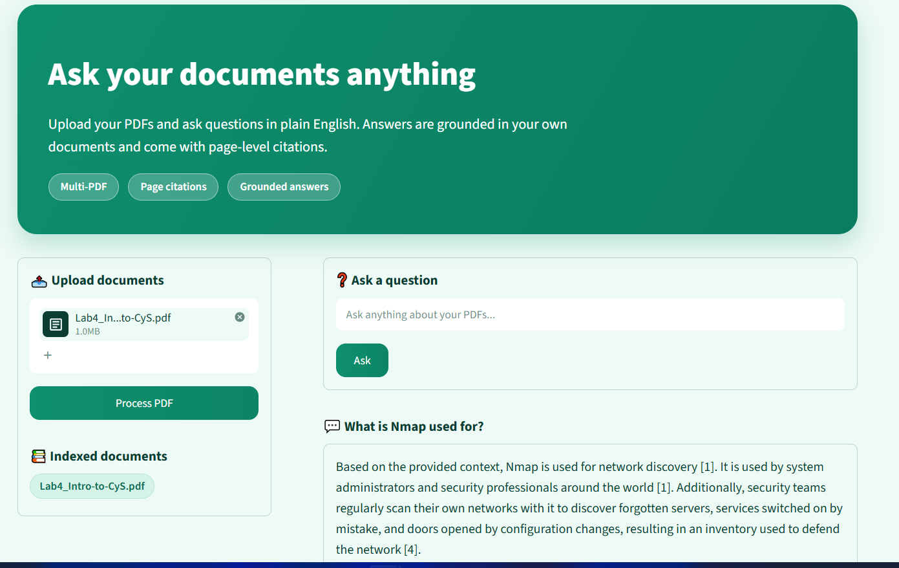
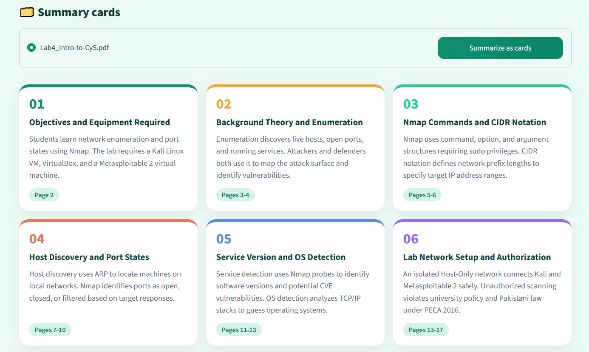

# PDF Q&A Assistant

Ask questions about your own PDFs and get answers with page-level citations. Built with a RAG pipeline (ChromaDB + Gemini) and a Streamlit UI.

**Live demo:** https://askmypdf-asad.streamlit.app

**Video demo (2 min):** https://youtu.be/P1oIzgy3HuQ



## Features
- **Multi-PDF upload:** index several PDFs and ask across all of them
- **Citations:** every answer points to the PDF and page it came from, with the source text shown below
- **Summary cards:** one click turns a document into section cards, each with a heading and a 2-line summary
- **Private index per visitor:** uploaded PDFs are indexed in a collection tied to your browser session
- **SQL log:** every question, answer, source list and latency is saved to SQLite
- **Measured quality:** answers scored with RAGAS (see Results)
- **Resilient LLM calls:** timeouts, retries and automatic fallback between Gemini models



## How it works
1. **Ingest:** `pypdf` extracts the text of each page, which is split into 800-character chunks with 150 characters of overlap. Each chunk keeps its PDF name and page number.
2. **Index:** chunks are embedded with ChromaDB's default embedding model and stored in a persistent ChromaDB collection.
3. **Retrieve:** the question is embedded and the 5 closest chunks are fetched.
4. **Answer:** Gemini gets only those chunks and is told to answer from them, cite them as [1], [2], and say "I don't know" when the answer is not there.
5. **Log:** the question, answer, sources and latency are written to SQLite.

## Tech stack
Python 3.12, pypdf, ChromaDB, Google Gemini (`google-genai`), Streamlit, SQLite, RAGAS

## Project structure
```
app.py            Streamlit UI
run_ragas.py      RAGAS evaluation script
src/ingest.py     PDF text extraction, chunking, indexing
src/qa.py         retrieval and cited answers
src/llm.py        Gemini calls with retry and model fallback
src/db.py         SQLite logging
src/summarize.py  summary cards
reports/          screenshots and evaluation results
```

## Run it locally
```
git clone https://github.com/asadehsan11/pdf-qa-rag.git
cd pdf-qa-rag
py -3.12 -m venv venv
venv\Scripts\activate
pip install -r requirements.txt
copy .env.example .env
```
Add your own key to `.env` (`GEMINI_API_KEY=...`), then:
```
streamlit run app.py
```

To run the evaluation, put PDFs in `data/raw`, then:
```
python -m src.ingest
pip install -r requirements-dev.txt
python run_ragas.py
```

## Results
Scored with RAGAS on 8 questions over 6 indexed lab manuals (cybersecurity, digital image processing, machine learning). Full per-question scores are in `reports/ragas_results.csv`.

| Metric | Average |
|--------|---------|
| Faithfulness | 1.00 |
| Answer relevancy | 0.87 |

How to read this: faithfulness 1.00 means every claim in the 8 answers was supported by the retrieved text. The test is small, and the judge model is Gemini (the same family that writes the answers), so treat the numbers as a sanity check, not a benchmark. The judge also generated one question instead of the usual three for answer relevancy, which makes that score noisier.

## Business value
Anyone who works through long documents (training manuals, policies, handbooks, lab guides) can find an answer in seconds instead of searching page by page. Because each answer shows its source page, a reader can check it quickly instead of trusting it blindly.

## Limitations
- Works with text-based PDFs only. There is no OCR for scanned pages, and tables and figures are not parsed.
- Very general questions (for example "what is an image") can retrieve weak passages and end in "I don't know". Questions that use the document's own wording work best.
- Uploaded text is sent to the Gemini API, so do not upload confidential documents.
- The free Gemini tier has rate limits and sometimes returns "high demand" errors. The app retries and falls back to other models, but a slow reply is possible.
- The SQL log is a local SQLite file, which free hosting does not guarantee to keep between restarts.
- The RAGAS test covers only 8 questions and does not measure retrieval recall.

## Author
Asad Ehsan - [LinkedIn](https://www.linkedin.com/in/asadehsan11/)
